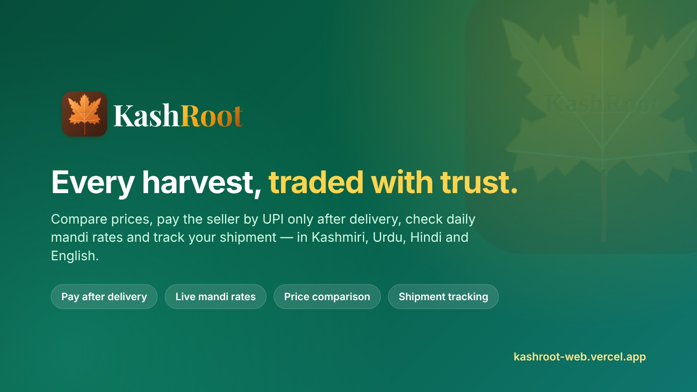

<p align="center">
  
</p>

<h1 align="center">KashRoot</h1>

<p align="center">
  <strong>Trusted trade, live market prices and logistics for producers, buyers and small businesses.</strong><br>
  Pay after delivery · Live mandi rates · Price comparison · Shipment tracking · Kashmiri, Urdu, Hindi &amp; English
</p>

<p align="center">
  <a href="https://kashroot-web.vercel.app"></a>
  
  
  
  
  
</p>

---

## Why KashRoot

In many mandis, growers sell without knowing the day's real price, buyers pay in advance for goods they have not seen, and nobody knows where a load is once the truck leaves. KashRoot replaces that guesswork with simple tools that work on any smartphone — including by voice for people who do not read or type easily.

It started with horticulture in Jammu & Kashmir (apple, walnut, saffron) and works for any trade where fair prices and reliable delivery matter.

## Features

| | Feature | What it does |
|---|---|---|
| 🛡️ | **Pay after delivery** | Buyers order now and pay the seller directly by UPI only after the goods arrive and have been checked. KashRoot never holds anyone's money. |
| 📈 | **Live mandi rates** | Daily official prices from Agmarknet (data.gov.in) for any state, district or market, per box, kg or quintal, with unusual prices flagged — plus rates posted and cross-checked by local **Mandi Helpers**. |
| ⚖️ | **Price comparison** | Growers, traders and dealers list produce and supplies; buyers compare offers side by side. |
| 🚚 | **Shipment tracking** | The driver shares location from their phone; the buyer sees the load live, distance left and the nearest place. |
| ❄️ | **Cold storage & machinery** | List and book storage space and equipment, with direct UPI payment to the owner. |
| 🧪 | **Input authenticity** | Check fertiliser and pesticide batches from a label photo, a batch number, or a lab report against Fertiliser (Control) Order standards. |
| 🌦️ | **Weather & orchard health** | Village-level hourly and 7-day forecasts with farm tips; apple-scab risk from local weather; photo checks; spray diary. |
| 👩‍🌾 | **Expert advice** | Ask an agronomist with crop photos, get written answers or a video call. |
| 🗣️ | **Voice assistant** | Answers about prices, weather and using the app, in Kashmiri, Urdu, Hindi and English. |
| 🪪 | **Verified accounts** | Sellers confirm identity (Aadhaar offline XML / Secure QR, PAN) before receiving money; only what is needed is stored — never a full Aadhaar number. |

**Portals:** Farmer · Buyer · Seller · Kissan Tools · Rental · Logistics · Tracking · Agro-dealer · Advisory · Mandi Helpers, each with its own sign-in, plus a private admin console.

## Architecture

```
Browser / Android (Capacitor)
        │
        ▼
Next.js 16 (App Router) on Vercel
  ├─ React 19 UI · Tailwind CSS · TanStack Query
  ├─ Route handlers: mandi prices, weather & places, IFSC, KYC, OTP, AI assistant
  └─ /api/supabase  same-origin auth proxy with rate limits
        │
        ▼
Supabase (PostgreSQL + Auth)
  ├─ Row-level security on every table
  ├─ SECURITY DEFINER functions for privileged actions (kr_*)
  └─ Security log written by database triggers

External data: Agmarknet / data.gov.in · Open-Meteo · OpenStreetMap (Photon, Nominatim) · Razorpay IFSC
```

## Security

- Strict Content-Security-Policy, HSTS, frame, referrer, permissions and cross-origin headers on every response.
- Sign-in through a same-origin proxy with per-account and per-IP limits against password guessing and floods.
- Row-level security everywhere; privileged operations only through audited database functions.
- Admin console hidden from public navigation, protected by a separate admin code with an idle lock, and recorded in a security log that cannot be edited from the website.
- Common-password blocking on sign-up and password reset.
- Secrets live only in Vercel environment variables — never in the browser bundle or the repository.

Found a security issue? Please contact the maintainer privately instead of opening a public issue.

## Getting started

**Requirements:** Node.js 20+, a Supabase project.

```bash
git clone https://github.com/waseemmushtaq173-hub/kashroot-web.git
cd kashroot-web
npm install
cp .env.local.example .env.local   # fill in your Supabase URL and anon key
npm run dev                        # http://localhost:3000
```

**Database:** open Supabase → SQL Editor and run [`supabase/RUN_THIS_ONCE.sql`](supabase/RUN_THIS_ONCE.sql). It creates every table, rule and function and is safe to run again. The individual steps are in [`supabase/migrations/`](supabase/migrations).

**Optional services** (each feature explains itself when its key is missing): `DATA_GOV_IN_API_KEY` for full mandi data, an Anthropic API key for the AI assistant, Fast2SMS or Gmail for OTP messages. See `.env.example` for the full list.

| Command | |
|---|---|
| `npm run dev` | Development server |
| `npm run build` | Production build |
| `npm run lint` | ESLint |

## Project structure

```
src/
  app/            Pages, portals and API route handlers
  components/     UI by feature (admin, auth, marketplace, tracking, voice, …)
  lib/            Data access, auth/session, server helpers (mandi, places, signing)
supabase/         SQL migrations and the one-file setup script
docs/             Logo, QR code and brand images
android/          Capacitor Android project
```

## Data sources & credits

- Market prices: [Agmarknet](https://agmarknet.gov.in) via [data.gov.in](https://data.gov.in) (Government Open Data License – India)
- Weather: [Open-Meteo](https://open-meteo.com) (CC BY 4.0)
- Maps & place search: © [OpenStreetMap](https://www.openstreetmap.org/copyright) contributors (ODbL), via Photon and Nominatim

## Contact

**Waseem Mushtaq Mir** — Founder
[Website](https://kashroot-web.vercel.app) · [LinkedIn](https://www.linkedin.com/in/kashroot-3103a3444/) · [Instagram](https://www.instagram.com/kash_root/) · [Facebook](https://www.facebook.com/share/1Eqiz9C8wy/)

© KashRoot. All rights reserved.
